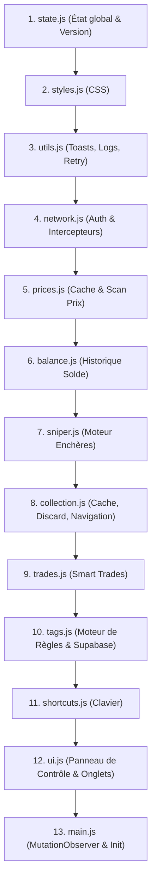

# WikiM (Wiki-Masters Tools)

Extension / Userscript modulaire pour enrichir l'expérience sur **Wiki-Masters** (enchères, sniper, prix du marché, tags automatiques, routines de trade, suivi du solde, navigation et raccourcis).

---

## 📁 Architecture et Ordre de Chargement

L'extension est divisée en 13 modules chargés séquentiellement par [`Tamper.user.js`](Tamper.user.js) via `new Function()` dans un ordre strict de dépendances :



| Ordre | Module | Rôle principal | Dépendances directes |
|:---:|---|---|---|
| **1** | [`src/state.js`](src/state.js) | État global, constantes de version, patch notes, initialisations partagées. | Aucune |
| **2** | [`src/styles.js`](src/styles.js) | Styles CSS du panneau, modales, badges, cartes et toasts. | `document.head` (ou fallback `DOMContentLoaded`) |
| **3** | [`src/utils.js`](src/utils.js) | Fonctions utilitaires, toasts, beeps, journalisation panneau, retry. | `window.wmConfig` |
| **4** | [`src/network.js`](src/network.js) | Capture JWT Supabase, intercepteurs `fetch` / JSON, recherche multi-comptes. | `unsafeWindow` / `window` |
| **5** | [`src/prices.js`](src/prices.js) | Cache des prix du marché, interrogation d'historique de ventes. | `network.js`, `utils.js` |
| **6** | [`src/balance.js`](src/balance.js) | Suivi du solde Wikibidous, delta 24h/7j, sparkline. | `state.js`, `utils.js` |
| **7** | [`src/sniper.js`](src/sniper.js) | Moteur d'enchères automatiques (Sniper), gestion des alertes. | `balance.js`, `network.js` |
| **8** | [`src/collection.js`](src/collection.js) | Cache de collection, défausse en masse, navigation fluide dans les modales. | `prices.js`, `network.js` |
| **9** | [`src/trades.js`](src/trades.js) | Routines d'échange automatiques (Smart Trades), calcul de rentabilité. | `prices.js`, `collection.js` |
| **10** | [`src/tags.js`](src/tags.js) | Gestion des étiquettes Supabase, règles conditionnelles, auto-tagging. | `network.js`, `collection.js` |
| **11** | [`src/shortcuts.js`](src/shortcuts.js) | Raccourcis clavier (`I`, `O`, `Espace`, flèches de navigation collection). | `collection.js`, `sniper.js` |
| **12** | [`src/ui.js`](src/ui.js) | Panneau de contrôle latéral et orchestration visuelle des onglets. | Tous les sous-modules |
| **13** | [`src/main.js`](src/main.js) | Point d'entrée, `MutationObserver`, injection des badges, API `window.wmDebug`. | Tous les modules |

---

## 📐 Conventions de Nommage et Exportations

- **Variables globales et état** : préfixées par `wm` (ex: `window.wmPrices`, `window.wmCollectionCache`, `window.wmAuth`).
- **Constantes de configuration** : en majuscules avec préfixe (ex: `WM_STYLES`, `WM_PATCH_NOTES`, `WM_VERSION`).
- **Exportations inter-modules** : chaque module expose directement ses méthodes sur `window` et `window.WikiM` sans encapsulation conditionnelle masquante :
  ```javascript
  window.maFonction = WikiM.maFonction = maFonction;
  ```

---

## 🛠️ Console et API de Débogage

Une API centralisée d'inspection est exposée dans la console du navigateur via `window.wmDebug` :
- `window.wmDebug.getAuth()` : inspecte le token Supabase et l'identifiant utilisateur courant.
- `window.wmDebug.prices` : affiche l'état actuel du cache des prix.
- `window.wmDebug.collectionCache` : inspecte les cartes de la collection chargées en mémoire.
- `window.wmDebug.fetchTags()` : synchronise manuellement les tags depuis la base Supabase.

---

## 🚀 Installation dans Tampermonkey

1. Installez l'extension [Tampermonkey](https://www.tampermonkey.net/) sur votre navigateur.
2. Créez un nouveau script dans Tampermonkey.
3. Copiez-collez l'intégralité du contenu du fichier [`Tamper.user.js`](Tamper.user.js).
4. Enregistrez (`Ctrl+S`).
5. Rendez-vous sur [Wiki-Masters](https://www.wiki-masters.com) : le script charge automatiquement les modules à jour.
6. *(Développeurs)* : Pour travailler localement, lancez `start-dev.bat` et passez `IS_LOCAL_DEV = true` dans `Tamper.user.js`.
